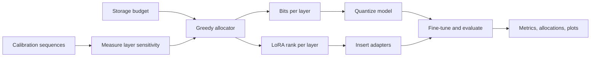
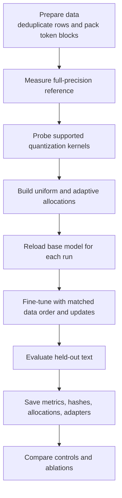
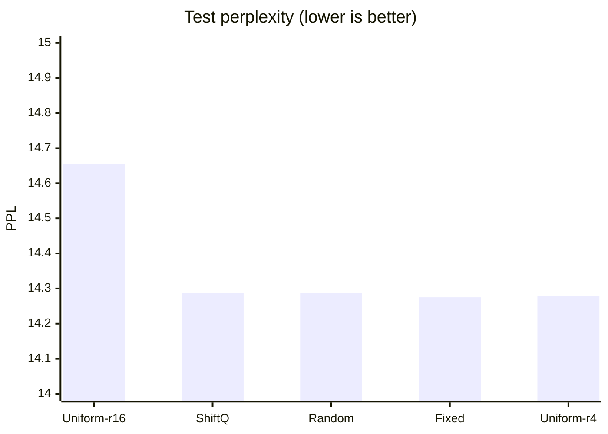

# ShiftQ

### Sensitivity-aware quantization and adaptive LoRA for language models

> **Research prototype · MLX · Apple Silicon**<br>
> A notebook study of mixed-precision weights and per-layer LoRA ranks under a fixed storage budget.

ShiftQ asks whether model layers benefit from different quantization bitwidths and LoRA ranks, compared with a uniform 4-bit, rank-16 setup. It is an experimental heuristic, not a novelty, performance, or deployment claim.

---

## At a glance

| | |
|---|---|
| **Implementation** | One research notebook: [`ShiftQ_Research.ipynb`](ShiftQ_Research.ipynb) |
| **Framework** | MLX / `mlx-lm` |
| **Primary model study** | Qwen3-1.7B |
| **Latest reviewed run** | `20261018T211742253834Z` |
| **Current takeaway** | No sensitivity-aware advantage established |

## The idea

Layers can differ in how much quantization error they tolerate and how much they benefit from adaptation. ShiftQ estimates per-layer reconstruction error, then greedily spends a target storage budget on bitwidth and rank upgrades.



The allocation score combines a layer’s estimated quantization error with a heuristic rank benefit. The budget accounts for packed weights, quantization metadata, unchanged parameters, and FP32 adapters. The score is a practical heuristic, not a learned or theoretically optimal allocation rule.

## Experiment flow



The notebook is organized as a runnable sequence: setup and data preparation, full-precision and uniform baselines, sensitivity scoring, allocation, quantization and LoRA insertion, training, evaluation, and ablations. Run cells in order.

## Latest reviewed result

The user-executed 1.7B study completed 25 configurations, including 20 training runs with 150 optimizer updates and seeds 42 and 43. Test perplexity is averaged across the two seeds on the same 64 WikiText sequences (16,384 prediction tokens).

| Method | Test PPL ↓ | Stored tensors |
|---|---:|---:|
| Uniform 4-bit / rank-16 | 14.656 | 1,037.73 MB |
| **ShiftQ** | **14.287** | **1,037.73 MB** |
| Random placement | 14.287 | 1,037.73 MB |
| Fixed placement | 14.275 | 1,037.73 MB |
| Uniform 4-bit / rank-4 | 14.278 | 985.43 MB |



ShiftQ is 2.52% lower in mean PPL than uniform rank-16 at the same recorded tensor size, but it closely matches random placement. Uniform rank-4 is slightly lower in mean PPL while using 5.04% less storage than ShiftQ. With two seeds and one evaluation split, these results do **not** establish a sensitivity-aware allocation benefit.

### What else the study found

- The bit-only policy selected uniform 4-bit, so that ablation is degenerate.
- Changing calibration text from WikiText to AG News changed 6 of 196 layer allocations.
- Fine-tuned methods had higher AG News PPL than the unquantized reference.
- Later ablations reported about 1.02 GB more active MLX memory than earlier comparable runs. The cause is unresolved; cross-phase memory comparisons need a fresh-process check.
- Validation minima occurred before the final update, but only final adapters were saved. The reported test comparison therefore uses final-step adapters, not validation-selected checkpoints.

## Run it

### Requirements

- macOS on Apple Silicon
- Python 3.12
- Internet access for model and dataset downloads

```sh
python3.12 -m venv .venv
source .venv/bin/activate
python -m pip install -r requirements.txt
python -m jupyter lab ShiftQ_Research.ipynb
```

In VS Code, select `.venv/bin/python` as the notebook kernel.

### Runtime settings

The notebook is configured for Qwen3-1.7B, 256-token contexts, two seeds, all comparisons, and 150 updates per training run. Full runs require `ALLOW_FULL_RUN=True`; 4B runs are manual.

For a quick smoke test, set:

```python
FAST_MODE = True
MODEL_ID = SMOKE_MODEL
TRAIN_STEPS = 20
```

Each run writes metrics, source-row hashes, token sequences, allocations, and adapters to `results/<run>/`, with plots in `figures/<run>/`.

## Methods and measurement notes

- Quantization probes 3-, 4-, 6-, and 8-bit options with group size 64; unsupported shapes are recorded.
- The MLX baseline uses affine quantization. It is QLoRA-style, but **not an NF4 reproduction**.
- Comparisons include unquantized and uniform quantization references, uniform/adaptive LoRA ranks, joint bit/rank allocation, random and fixed controls, rank ablations, and calibration shift.
- Stored tensor bytes include quantization metadata and FP32 adapters. MLX allocator memory is reported separately; neither measurement is process RSS.
- Timing measures synchronized forward passes without a KV cache, not generation or decode speed.
- Training peaks exclude setup and validation.

## Reproducibility and artifacts

The latest detailed artifact review is [`results/20261018T211742253834Z/review.json`](results/20261018T211742253834Z/review.json). It records the study scope, metrics, validation minima, integrity audits, limitations, and next steps. The overall workspace status is in [`results/status.json`](results/status.json); source notes are in [`results/literature.csv`](results/literature.csv).

The saved runs preserve metrics, allocation decisions, data provenance, and adapter artifacts. The latest study was reviewed from user-executed outputs; it was not independently rerun during that review.

## Next steps

1. Re-measure representative memory configurations in fresh kernels or processes with matched setup and warm-up.
2. Predefine a validation-selected checkpoint study with more seeds and fresh held-out text.
3. Keep the current test results separate from any future tuning.
